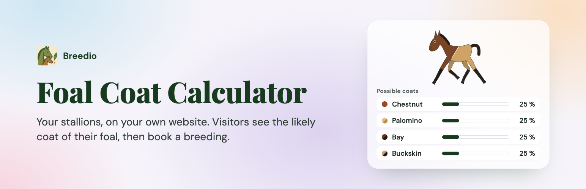
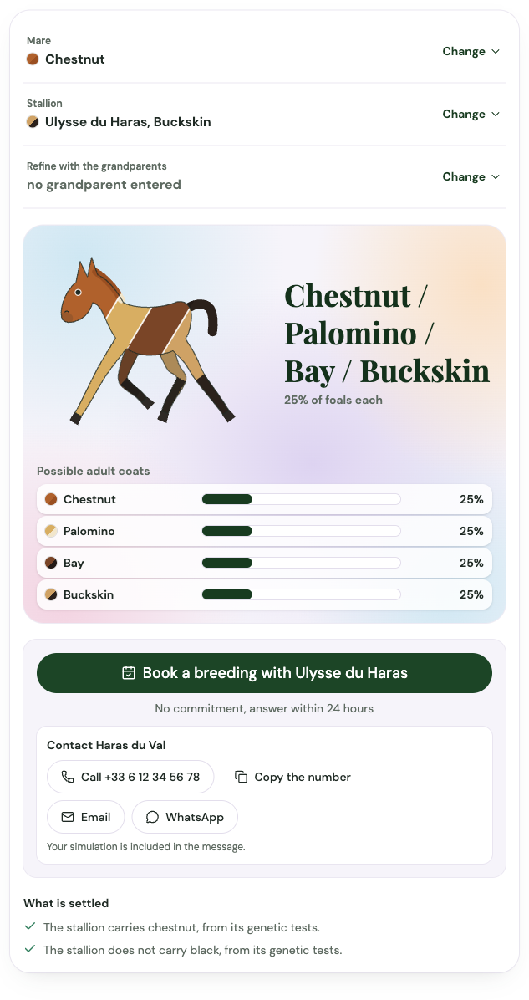

# Breedio Foal Coat

A WordPress plugin for stud farms: visitors pick the coat of their mare and see the possible coats of the foal with each of your stallions, with probabilities, right on your own website.

- Plugin on WordPress.org: https://wordpress.org/plugins/breedio-foal-coat/
- Online calculator: https://www.breedio.xyz/en/tools/foal-color-calculator
- Made by [Breedio](https://www.breedio.xyz/en), free tools for horse breeders

## What it does

**For the stud**

- Stallions are stored in your WordPress site, under Foal coat in the admin menu: coat, coat of the sire and dam, and genetic test results when you have them (Extension, Agouti, Cream, Champagne, Silver, Dun, Grey, Roan, Tobiano, Frame overo).
- Add the calculator with the "Foal coat calculator" block or the `[breedio_foal_coat]` shortcode.
- Link a page to a stallion: the calculator on that page opens with this stallion selected.
- A "Book a breeding" button under the result opens the booking page of the stallion, or shows your phone, email and WhatsApp with the simulation already written in the message.

**For the visitor**

- Predict mode: choose a stallion and the coat of the mare, and see every possible coat of the foal with its probability.
- Match mode: choose the coat of the mare and the coat they want, and see the three stallions most likely to give it.
- Optional grandparents refine the result when the mare was never tested.
- English, French, Spanish, Italian and German, following the language of the site.

## Install

From your WordPress admin: Plugins > Add New, search for "Breedio Foal Coat", install and activate.

From this repository: download the ZIP, upload it under Plugins > Add New > Upload Plugin.

Then:

1. Under Foal coat > Settings, enter the phone, email or WhatsApp number shown under the "Book a breeding" button.
2. Under Foal coat > Add a stallion, enter the coat of each stallion, the coats of its sire and dam, and its genetic tests.
3. Add the "Foal coat calculator" block or the shortcode to a page.

Requires WordPress 6.5 and PHP 7.4.

## Shortcode

| Shortcode | Result |
|---|---|
| `[breedio_foal_coat]` | Calculator with the stallion of the page, otherwise the first one |
| `[breedio_foal_coat stallion="12"]` | Calculator opened on stallion 12 |
| `[breedio_foal_coat mode="match"]` | Stallion finder for a desired coat |

## For developers

- Filter `breedio_foal_coat_roster`: change the data passed to the calculator (stallions, contact, mode).
- Action `breedio_foal_coat_render`: runs each time a calculator is rendered, with the roster.
- Constant `BREEDIO_FOAL_COAT_ORIGIN`: origin of the calculator iframe, `https://embed.breedio.xyz` by default.
- The iframe posts `breedio:coat-*` messages; the plugin resizes the frame and re-dispatches the others on `window` as `breedio-foal-coat:*` custom events.

## Privacy

The calculator is displayed in an iframe served by Breedio (`https://embed.breedio.xyz`), which runs the genetic calculation. The plugin passes your published stallions and your contact settings in the URL fragment, which browsers never send to a server. The iframe sets no cookie and the plugin collects no visitor data.

Nothing on your public pages links to Breedio unless you turn on the optional "Calculator by Breedio" credit in the settings.

- Terms: https://www.breedio.xyz/en/terms
- Privacy policy: https://www.breedio.xyz/en/privacy

## Breedio Foal Coat Pro

The calculator, the stallions and the contact card are free and stay free. An optional paid add-on adds a call back form with the simulation attached, breeding requests kept in WordPress and sent by email, and statistics per stallion: https://www.breedio.xyz/en/wordpress

## Contributing

Bug reports and suggestions are welcome in the issues. This repository follows the version released on WordPress.org.

## License

GPL-2.0-or-later. See [LICENSE](LICENSE).
